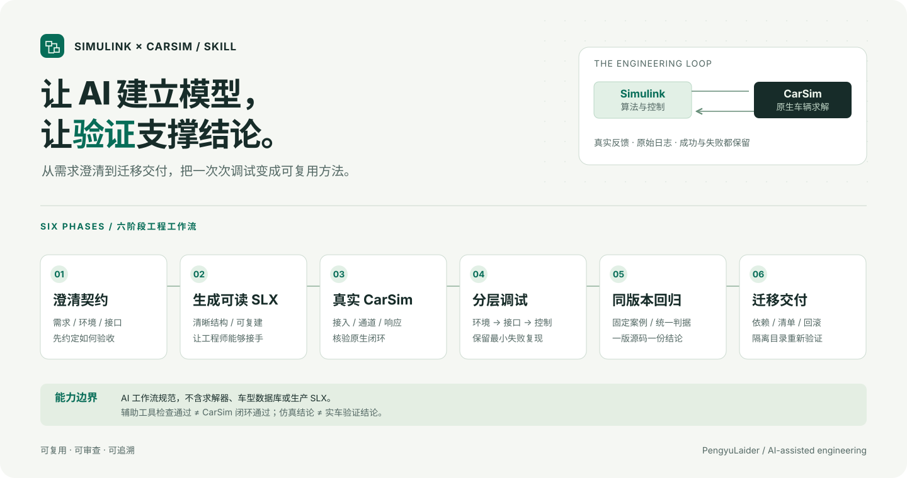

# Simulink × CarSim Co-simulation Skill

**让 AI 生成可读的 Simulink 模型，再用真实 CarSim 反馈验证它。**

从需求澄清、程序化建模，到原生接口联调、故障复现、同版本回归和迁移交付的一套可复用工作流。适合自动泊车、轨迹跟踪、制动与其他车辆控制项目；车辆、算法、通道和验收阈值由目标工程决定。



[Skill 正文](skills/simulink-carsim-cosim/SKILL.md) · [展示页](docs/index.html) · [上传说明与发布文案](GITHUB_UPLOAD.md) · [验证记录](VERIFICATION.md)

## 它解决什么

| 常见问题 | Skill 要求 AI 怎样做 |
|---|---|
| 只有路径图，无法确认算法在哪里运行 | 建立可查看、可重建的 SLX，核对生产执行链 |
| CarSim 打开了，却没真正联合仿真 | 检查实际 S-Function、数据、端口与原生反馈 |
| 单次演示成功，用户点击仍然失败 | 复现原场景，覆盖真实操作及失败恢复 |
| 每次修好一个问题，又出现另一个 | 同一冻结源码执行约定回归，不拼接通过记录 |
| 换电脑就失效 | 清点依赖，在新解压目录核对入口与实际运行 |

## 安装与调用

把 **`skills/simulink-carsim-cosim` 文件夹**复制到宿主支持的技能目录。支持仓库级 Codex 技能发现的环境可用：

```text
你的项目/
└─ .agents/skills/simulink-carsim-cosim/
   ├─ SKILL.md
   ├─ agents/
   ├─ references/
   └─ scripts/
```

个人技能目录以当前宿主配置为准；不要只复制 `SKILL.md` 而遗漏资源。[官方说明](https://learn.chatgpt.com/docs/build-skills)

```text
使用 $simulink-carsim-cosim，先检查当前项目和已安装版本，
把我的控制算法建立为可查看的 Simulink 模型，连接本机 CarSim。
先验证单位、坐标和实际车辆响应，再完成闭环、失败恢复与回归。
已有模型和原始失败记录请先保留；无法执行的验证明确标注。
```

## 六个阶段与工具

需求与接口契约 → 可读 SLX → 真实 CarSim 接入 → 分层调试 → 同版本回归 → 迁移交付。

- `model_inventory.m`：读取**已加载且已停止**模型及 S-Function 解析信息，不编译、不保存。已在 R2024b 验证；默认不展开掩码、库和引用模型，需另行检查这些依赖。
- `fingerprint.py`：对选定源码和数据建立指纹，检测新增、删除和修改；不判断物理正确性。

```text
python -m unittest discover -s tests -v
```

这些测试检查 Skill 资源与辅助工具，**不会在 GitHub 上运行 CarSim**。

## 使用边界

需要本机合法可用的 MATLAB/Simulink、CarSim 及目标工具箱。本仓库提供方法和工具，不提供生产 SLX、车型参数、求解器、许可或厂商二进制。

编译通过不等于闭环通过；固定回归不等于随机成功率；仿真不等于实车验证。

本仓库新写的文档与工具采用 [MIT 许可证](LICENSE)。MATLAB、Simulink、CarSim 和第三方车辆数据遵循各自许可。

## 展示与资料

可直接打开 `docs/index.html` 查看离线界面；GitHub 代码页不会直接执行 HTML，上传文件也不自动启用 GitHub Pages。

[接口与建模](skills/simulink-carsim-cosim/references/modeling-and-interface.md) · [调试与验收](skills/simulink-carsim-cosim/references/debugging-and-validation.md) · [迁移](skills/simulink-carsim-cosim/references/packaging.md) · [官方来源](skills/simulink-carsim-cosim/references/sources.md)

Independent workflow documentation; not affiliated with MathWorks or Mechanical Simulation.
